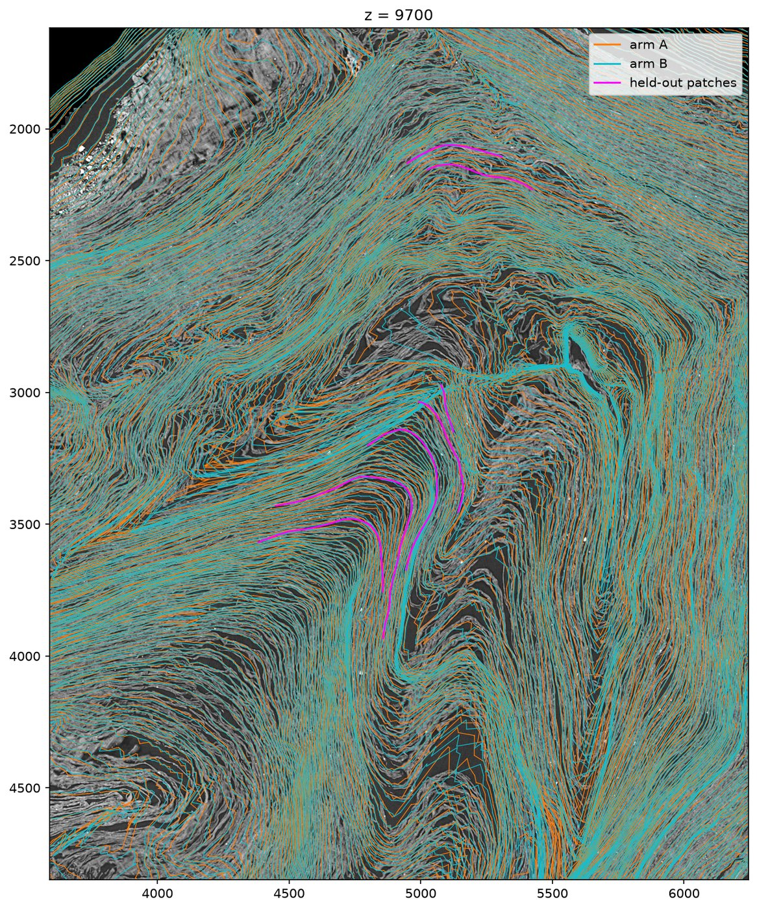

# spiral-patches-ab

**Do automatic sheet patches make the spiral fit better on a First Letters scroll?** A pre-registered, paired A/B of
villa's spiral fitter on PHerc. 0813 z 9000-10000: arm A uses the published surface tracks only; arm B adds 13
machine-grown single-sheet patches. Both arms are scored on 7 other patches that neither fit saw.

**Result (seed 1, 24 October 2026): NO-GO by the pre-registered bar, with a small real gain.** Adding the patches
put 35.7 % of held-out patch nodes within 2 voxels of a fitted winding, against 32.3 % with tracks only: B-A
**+3.5 points (95 % CI +0.9 to +5.8)**, better on 6 of the 7 held-out patches, with no more stacking
(duplicate-sheet share 20.8 % vs 21.3 %). The bar fixed in advance was +5 points, so this does not count as a
success. On this heavily folded band neither fit is good: about 10.5 % of tracks are satisfied in both arms, and
each held-out patch touches 3 to 13 different fitted windings. A second seed is queued and will be reported
whatever it shows; the decision stays with seed 1. [PREREG.md](PREREG.md) (amendment 1, after the smoke test and
before the fits, relaxed one validity check).

## Results (seed 1)

Both runs are valid under the pre-registration: 1,270,348 tracks loaded, Lasagna normals pool 9,762 bricks, arm A
no patches, arm B the 13 training patches and none as verified, each eval pass resumed with 0 steps and scored the
7 held-out patches, eval satisfied tracks within 0.5 % of the fit, shared GPU memory 86 MB. Each 20,000-step fit
took about an hour on one RTX 3090.

| | A: tracks only | B: tracks + 13 patches | B-A (paired bootstrap over the 7 patches) |
|---|---|---|---|
| held-out nodes within 2 voxels (primary) | 32.3 % | 35.7 % | **+3.5 points [+0.9, +5.8]** |
| held-out nodes within 4 voxels | 57.9 % | 59.3 % | +1.4 points [+0.1, +3.5] |
| duplicate-sheet share (two windings on one sheet) | 21.3 % | 20.8 % | -0.5 points |
| winding hops inside held-out patches | 1,088 (6 of 7 patches) | 1,140 (7 of 7) | |
| fitter's held-out satisfaction (area) | 21.9 % | 24.4 % | +2.5 points |
| satisfied tracks | 10.5 % | 10.4 % | |

Per held-out patch, nodes within 2 voxels (A → B): s001 365 → 435 of 774, s002 181 → 185 of 448, s010 561 → 553
of 1,249, s012 217 → 220 of 847, s015 483 → 573 of 1,861, s026 125 → 159 of 624, s043 130 → 158 of 587.

Cross-sections at z = 9500, 9700 and 9900 (`figures/`) show why the numbers are low in both arms: this part of
PHerc. 0813 is folded, and the fitted windings of both arms cross the sheets in many places. Patches nudge the fit
near them, but they do not stop the hops.

What this means for using patches on eligible scrolls: machine-grown single-sheet patches did not hurt (unlike our
August Paris 4 screen, where bulk machine patches lowered held-out fiber consistency), and they helped a little away
from where they were placed, but on a band this folded they are not enough to fix the fit. The test is small (7
held-out patches, 2.3 cm2, one seed). `results/score_ab.json`, `results/fitter_summary.json`.

## Why

The spiral fitter places windings from tracks, patches, fibers and winding annotations, but on the scrolls still in
the First Letters prize only the tracks exist: verified patches, fibers and winding annotations are published for
PHerc. Paris 4 only. Fits on eligible scrolls hop windings or lay two windings on one sheet (about a fifth of the
fitted area duplicates another winding on PHerc. 0191 and 0813 in skuzbucket1's measurements). The spiral tutorial
says patches or fibers give "more bang for your buck" than winding annotations against sheet switches, and on
Paris 4 the maintainers already feed tens of thousands of automatically grown patches through the patch input. Nobody
had published whether automatic patches help a fit on an eligible scroll. This repository asks that, on one band,
with a held-out test.

## Design (details in PREREG.md)

| | |
|---|---|
| Scroll, band | PHerc. 0813, volume 20250821151723 (9.362 um), z [9000, 10000), spiral sense CW from the catalog flags |
| Code | villa 0fb38c45 (the recipe the First Letters fits use) + `patches/villa_0fb38c45_local.diff` |
| Tracks | the published tracks cut to the band by byte-range reads (`tools/cut_band_tracks.py`, 0.86 GiB fetched instead of the 8.17 GB store); the fitter loads exactly 1,270,348 tracks, as from the full store |
| Normals | published Lasagna nx/ny, group 2 |
| Patches | the 21 PHerc. 0813 patches of [Ahggggg/first-letters-clean-sheets](https://github.com/Ahggggg/first-letters-clean-sheets) (CC BY-NC 4.0; not redistributed here, ids and split in `dataset/patches_split.json`) |
| Split | 1 flagged patch dropped; held out if the mean z of its in-band nodes >= 9600: 13 training (13.45 cm2), 7 held out (2.32 cm2), every held-out node >= 204.7 voxels from every training node |
| Arms | identical (seed 1, 20,000 steps, DT losses from step 10,000) except arm B loads the 13 training patches as unverified patches |
| Primary metric | share of held-out patch nodes within 2 voxels of the nearest fitted winding |
| Decision | GO only if B-A >= +5 points, the paired bootstrap 95 % interval (over patches) is above 0, and the duplicate-sheet share rises by at most 2 points |

The test has little power (7 held-out patches, one seed), and the patches are machine-grown and unverified, so
arm B can be worse than arm A. Both outcomes are reported.

## Files

- `PREREG.md`: the pre-registration.
- `score_ab.py`, `tests/`: CPU scoring (exact point-to-triangle distances, winding hops, skuzbucket1's duplicate-sheet
  share re-implemented with credit, paired bootstrap, the GO rule, CT cross-sections); `python -m pytest tests`.
- `tools/cut_band_tracks.py`, `tools/verify_band_tracks.py`: cut a published track store to a z band without
  downloading it, and check the fitter loads exactly the same tracks.
- `tools/prep_patches.py`: the patch split. `tools/mirror_zarr*.py`, `tools/pack_lasagna.py`: the normals.
- `configs/`, `jobs/`: the fit settings and the GPU jobs (paths are this machine's; the fits run on one RTX 3090).
- `dataset/`: the scroll spec, catalog orientation, umbilicus (AlexeyDrobkovStrikesBack/herculaneum-umbilici, MIT)
  and the split.

## Credits

Patches: Ahggggg/first-letters-clean-sheets (CC BY-NC 4.0). Duplicate-sheet metric: skuzbucket1/scroll-prize
(geometry-coverage). Umbilicus: AlexeyDrobkovStrikesBack/herculaneum-umbilici. Held-out patch scoring for spiral
fits was done before on Paris 4 and PHerc. 1218 by Nicodol/spiralcheck; PCU (Jashann/vesuvius-scrolling) compared
tracks only with published patches on Paris 4. The fitter, tracks and normals are the Vesuvius Challenge team's
(ScrollPrize/villa).

Code MIT. Developed with AI assistance under my direction.
